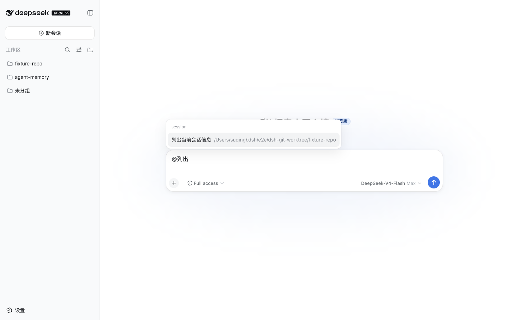

# dsh-plugins

English | [中文](README.zh.md)

Third-party plugins for [DeepSeek Harness (DSH)](https://github.com/deepseek-ai/deepseek-harness). Each directory under `packages/` is an independently installable plugin.

The released `0.2.0` set is verified with `@deepseek-ai/dsh@0.1.0-rc.6`. Repository source targets DSH `0.2.2-rc.1`, Cordis `4.1.0`, and Node.js `>=24.9.0`; older DSH cohorts are no longer declared supported by this source set. See the [compatibility record](docs/design/dsh-0.2.2-migration.md) for verification scope. On 2026-10-06 five packages were retired — `dsh-agent-plugins`, `dsh-thinking-collapse`, `dsh-codex-login-dock`, `dsh-openai-codex-oauth`, and `dsh-composer-skill-mention` — and `dsh-worktree-workspaces` was retired on 2026-11-04. The two packages below are the maintained set. That source set is not published yet. An additional experimental package, [`dsh-codex-bridge`](packages/dsh-codex-bridge/README.md) (read-only Codex Home compatibility), is tracked in `packages/` but is neither published nor part of that maintained set.

## Install

The historical published release below requires Node.js 22 or later and `pnpm` on `PATH`. It is not the current DSH `0.2.2-rc.1` source adaptation. Install only the plugins you need into the matching DSH Web profile:

```bash
dsh plugin --profile web add @suqingsq/dsh-session-tools@0.2.0
```

Each package is independently installable. The command pins the plugin release verified with DSH `0.1.0-rc.6`; the full scoped set was also installed and loaded in the daily DSH `0.1.0-rc.7` Web profile before retirement. `dsh-ui-zoom` is not published yet, so it has no install command.

The previous unscoped package names are deprecated. For the retired packages their scoped replacements are no longer maintained.

## Plugins

### [@suqingsq/dsh-session-tools](packages/dsh-session-tools/README.md)

Six model-facing session tools, plus Web `@` candidates that inject another session as sourced context.



### [@suqingsq/dsh-ui-zoom](packages/dsh-ui-zoom/README.md)

Whole-interface zoom for the Web and Desktop GUI: a Settings row with −/+ and reset, plus a durable per-profile zoom percentage. Not published yet.

## Repository

This is a pnpm workspace. Package conventions are in [AGENTS.md](AGENTS.md). The plugin index is in [`packages/README.md`](packages/README.md), and release history is tracked in [CHANGELOG.md](CHANGELOG.md).

## License

[MIT](LICENSE)
