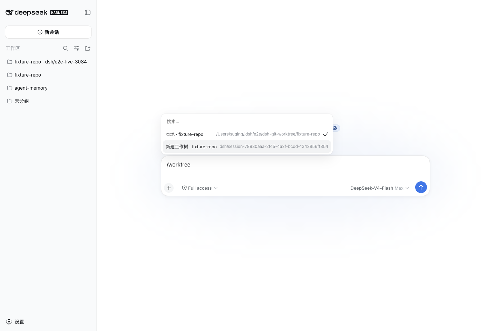

# @suqingsq/dsh-worktree-workspaces

[English](README.md) | 中文

为 DeepSeek Harness 创建和归档 Git linked worktree。同一包提供 `/worktree` 斜杠命令、`worktree_create` 模型工具、`dsh-worktree` CLI，以及用于切换 DSH Workspace 的 Web 弹层。

编译与包测试目标为 `@deepseek-ai/dsh@0.2.1-rc.5`，包含原生本地文件系统、子进程与沙箱 provider 回归；真实 profile 验证单独记录在设计文档中。

## 安装

```bash
dsh plugin --profile web add @suqingsq/dsh-worktree-workspaces@0.2.0
```

卸载命令：`dsh plugin --profile web remove @suqingsq/dsh-worktree-workspaces`。

## 做什么

Git 自身的 `git worktree list --porcelain -z` 是工作树事实源；DSH Workspace 只负责 Web/会话入口。本包不建立第二套台账。



## `/worktree`

这些命令直接执行，不发送给模型。

| 输入 | 结果 |
| --- | --- |
| `/worktree status` | 打印仓库根目录、当前路径、分支和工作树数量。 |
| `/worktree new [分支]` | 创建新分支和 linked worktree，并注册为 DSH Workspace。省略分支时使用 `dsh/<session-id>`。 |
| `/worktree` | 在 Web 上打开 `popupSelect`：**本地**（原 checkout）、**工作树**（当前已在托管工作树里时）、**新建工作树**。选中「新建工作树」后创建工作树并切换到新的 Workspace 会话。Headless 则返回状态。 |

源仓库的未提交改动不会被复制。本包自己不会创建 DSH session；Web 上用户选择成功后，由 DSH Workspace UI 为目标 Workspace 创建或复用空白 session。导航和菜单分类依据 Git 规范路径及稳定的 Workspace ID，不依赖显示标题；复用已有 Workspace 时保留用户自定义标题。

## `worktree_create`

模型需要编排 Git 工作树时使用，返回供新会话使用的绝对 `cwd`。省略 `repository` 时使用经校验的会话当前工作目录；显式相对路径也以该有效目录解析。模式：

- `new-branch` — 新建本地分支（可选 `startPoint`，默认 `HEAD`）
- `existing-branch` — 检出已有本地分支
- `detached` — 在 `startPoint` 或 `HEAD` 上 detached HEAD

Host 命令与模型工具使用 DSH 挂载的文件系统和子进程 provider，原样遵守调用者的沙箱策略；目录创建和清理与 Git 一并受限。配置 `baseDir` 不会授予额外写权限：在 `workspace-write` 下应将其设在获准工作区内。每个 Host 子进程均限制输出与执行时长，支持取消，并等待所管理的进程范围退出。

## 客户端 API

0.4.0 修改了已导出的客户端 helper 契约。`worktreeOptions(items, sessionId, location)` 要求传入 `WorktreeLocation`，由 `/worktree status` 的 `statusResult.text` 通过 `worktreeLocation()` 解析。创建后使用 `waitForWorkspace(source, workspaceReceipt(createResult.text))`，目标改为 `{ workspaceId, path }` 而非显示标题。回执解析器和类型从 `./protocol` 入口导出。内置弹层已使用新契约，不降级回标题匹配。

## CLI

```bash
dsh-worktree create --repo /path/to/repository --branch suqing/my-task --at HEAD
dsh-worktree create --repo /path/to/repository --existing my-branch
dsh-worktree create --repo /path/to/repository --detach --at HEAD
```

默认布局：

```text
~/.dsh/worktrees/<worktree-id>/<repo-name>/
```

命令返回 JSON。`next.cwd` 是新 DSH 会话应选择的目录。`sourceDirty: true` 表示源仓库存在未提交修改；这些修改不会被复制。

预览根目录 mtime 超过 7 天的候选项，再执行归档：

```bash
dsh-worktree archive --days 7
dsh-worktree archive --days 7 --apply
```

归档使用 `git worktree move`。locked、非 linked worktree、越界路径和不符合两层布局的目录不会移动。执行结果写入：

```text
~/.dsh/archived_worktrees/<timestamp>/manifest.jsonl
```

mtime 只是年龄启发式，不代表 DSH 会话最后活跃时间。CLI 不会自己定时跑。归档后的 worktree 仍保持 Git 连接，可以直接在归档路径继续工作，或用 `git worktree move` 移回。

CLI 是独立的原生 Node 进程，使用启动账号的系统权限，而非 DSH 会话策略；它不读取 Cordis profile 配置，也不依赖 Host 服务。`--base-dir`、`--archive-dir` 可覆盖默认的 `~/.dsh/worktrees` 和 `~/.dsh/archived_worktrees`。

## Bundle 配置

```yaml
- id: worktree-workspaces
  name: '@suqingsq/dsh-worktree-workspaces'
  config:
    baseDir: '~/.dsh/worktrees'
```

## 验证

兼容边界与验证证据记录在[设计文档](https://github.com/SisyphusSQ/dsh-plugins/blob/main/docs/design/dsh-worktree-workspaces.md)中。已发布版本的兼容基线为 `@deepseek-ai/dsh@0.1.0-rc.6`；迁移后的源码目标版本为 `@deepseek-ai/dsh@0.2.1-rc.5`。

## License

[MIT](LICENSE)
